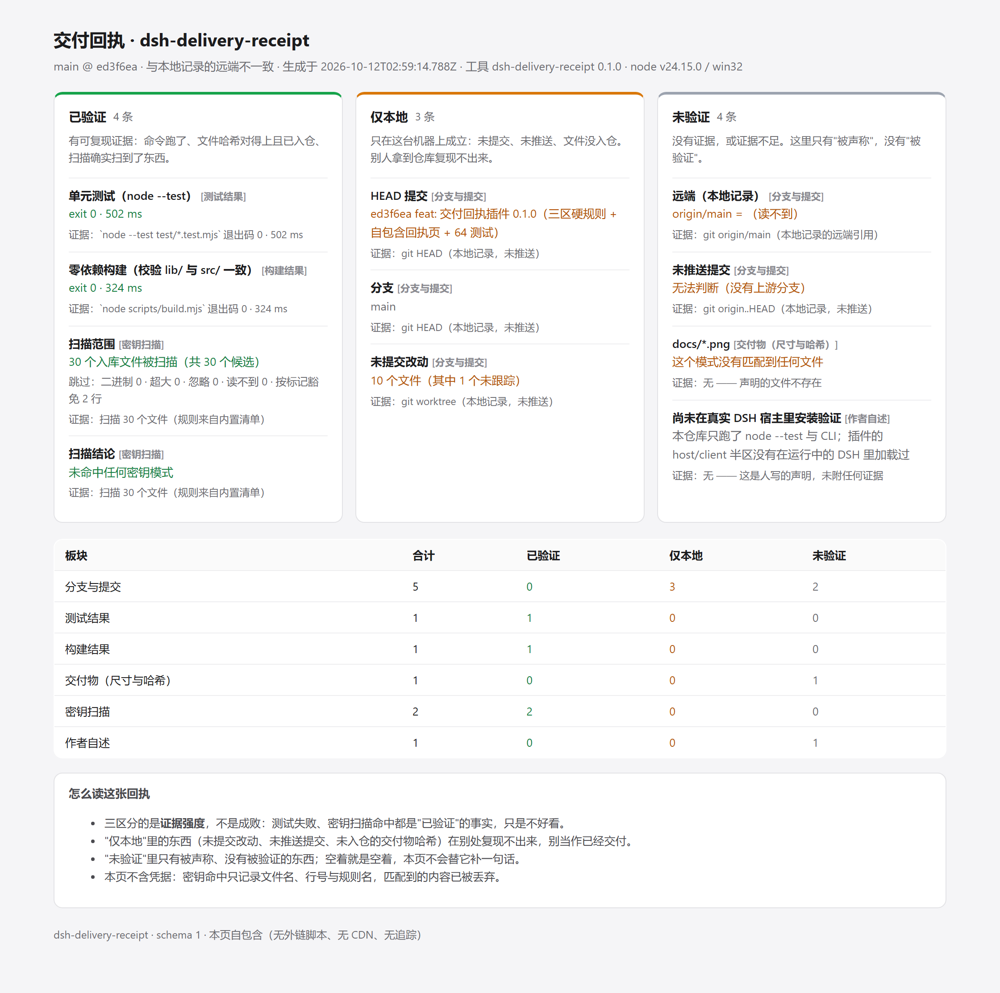

# dsh-delivery-receipt（交付回执）

给 DeepSeek Harness 的**交付回执**插件：项目收尾时按一下，把「分支与 commit、测试与构建结果、
关键截图尺寸与 sha256、密钥扫描结论」汇成一张可以拿出去给人看的页面 —— 并且把每一条声明
**硬性**分进「已验证 / 仅本地 / 未验证」三区。**没有证据的板块留空，不补话。**

## 为什么要有它

收尾汇报每次都要手写一遍：写少了漏证据，写多了越界（把"我这台机器上是这样"说成"已经交付"）。
生态里的状态类插件（`2008924/dsh-progress-viz`、`133563825as-ai/dsh-api-dashboard`）都是**给自己看的实时面板**；
名字相近的 `dsh-receipt` 系列（如 `bluechips-zhao/dsh-receipt`、`louisyeaaah/dsh-receipt`）是**会话/用量小票**（token、耗时、成本、热敏打印）。
它们都不回答"这份交付里，哪几条是别人能复现的，哪几条只在你机器上成立"。

这个插件把这件事变成一条可测试的规则：

| 区 | 判定（只看证据，不看措辞，也不看成败） |
|---|---|
| **已验证** | 证据来自本次采集且能在别处复现：命令确实跑了（退出码就是事实）、文件哈希且文件已入版本库、扫描确实扫到了文件、git 引用在本地记录的远端里 |
| **仅本地** | 只在这台机器上成立：未提交改动、未推送提交、交付物未被 git 跟踪（别人拿到仓库看不到这个哈希） |
| **未验证** | 没有证据或证据不足：命令没运行/超时、声明的文件不存在、扫描 0 个文件、以及**人写的任何一句话** |

> ⚠️ **「已验证」不等于「是好消息」**：测试失败、密钥扫描命中都是**有证据的事实**，同样进已验证区，只是带红色色调。
> 三区分的是**证据强度**，不是成败。

## 安装

```sh
dsh plugin --profile <你的 profile> add dsh-delivery-receipt
```

也可以从 GitHub 直装：`dsh plugin --profile <你的 profile> add github:dingchenhui0618-arch/dsh-delivery-receipt`。
装好后重启 DSH，对话视图里出现「交付回执」Tab。

## 配置：`delivery-receipt.json`（放在项目根）

```json
{
  "project": "my-project",
  "tests":   [{ "name": "单元测试", "command": "node --test test/*.test.mjs" }],
  "builds":  [{ "name": "构建", "command": "node scripts/build.mjs" }],
  "artifacts": ["docs/*.png"],
  "scan": { "ignore": ["docs/big-demo.html"] },
  "claims": [{ "label": "已内部评审", "value": "2026-10-12 通过" }],
  "runCommands": true
}
```

| 字段 | 作用 |
|---|---|
| `tests` / `builds` | 生成回执时会**执行**并把退出码、通过数、耗时写进回执。写法可以是字符串或 `{name, command}` |
| `artifacts` | 交付物模式：精确路径或 `目录/*.png`。会记录字节数、sha256、图片尺寸、以及**是否已入版本库** |
| `scan.ignore` | 密钥扫描跳过的路径前缀 |
| `scan.allowMarker` | 逐行豁免标记，默认 `delivery-receipt:allow`。测试夹具、文档示例这类"像凭据但不是凭据"的行，在行尾写上标记即可豁免；**豁免了多少行会原样出现在回执里**，不是静默放过 |
| `claims` | 你要说的话。**永远进未验证区** —— 能附证据的东西应该写成上面那些字段 |
| `runCommands` | 默认 `true`；设 `false` 只采集不执行 |
| `cwd` | 可选：覆盖采集目录（相对路径按配置文件所在目录解析） |

## 用法

装好插件后：对话视图 →「交付回执」→ 点「生成回执」。面板会先列出**这次会执行哪些命令**，
再按三区展示结果；「打开回执页」给出自包含的 HTML（可直接存文件/发出去），「复制 Markdown」给 PR 或聊天用。

不装 DSH 也能用：

```sh
node scripts/receipt.mjs                     # 打印摘要
node scripts/receipt.mjs --out receipt.html  # 落盘自包含页面
node scripts/receipt.mjs --md                # 打印 Markdown
node scripts/receipt.mjs --no-run            # 只采集，不执行命令
```

本仓库自己的回执（dogfood，含真实的 sha256 与扫描结论）：[docs/receipt-example.md](docs/receipt-example.md)



## HTTP 接口

| 方法 | 路径 | 说明 |
|---|---|---|
| GET | `/dsh-delivery-receipt/state` | 当前配置、将要执行的命令、上次回执摘要 |
| POST | `/dsh-delivery-receipt/generate` | 生成一次回执（body 可带 `{"cwd": "..."}`，但必须在白名单内） |
| GET | `/dsh-delivery-receipt/receipt.html` | 自包含回执页（未生成时是明确的"还没有"页） |
| GET | `/dsh-delivery-receipt/receipt.md` | 同一份内容的 Markdown |
| GET | `/dsh-delivery-receipt/receipt.json` | 回执对象（未生成时 404） |

## 安全边界（重要）

- **要执行的命令只来自配置文件**（`delivery-receipt.json` 或插件配置的 `receiptConfig`），
  **永远不来自 HTTP 请求**。`test/host.test.mjs` 里有一条测试专门往请求体塞 `command` 和假的 `tests`，断言执行器一次都没被调用。
- **能采集的目录只来自插件配置**：`cwd` 与 `roots` 白名单。请求里带的 `cwd` 不在白名单内一律 403 且不采集。
- **不联网**：远端状态读本地的 `refs/remotes/origin/*`，回执里标注为「本地记录的远端状态」，不把离线缓存说成实时事实。
- **不落凭据**：密钥扫描命中只记录 `文件:行号 + 规则名`，匹配到的内容、长度、摘要都不写；所有进入页面的文本再过一次脱敏（`ghp_…`、`sk-…`、私钥块、内联 Bearer、赋值型口令），家目录归一成 `~`。仓库里有一条测试断言"密钥字符串及其前缀不出现在序列化结果里"。
- **夹具误报有出口，而且不是静默的**：测试里必然会出现"像凭据的字符串"，所以扫描支持逐行豁免标记（默认 `delivery-receipt:allow`）。豁免的行数会写进回执的扫描范围一栏 —— 你可以看到放过了 3 行，而不是被瞒着。
- **自包含**：回执页没有外链脚本、没有 CDN、没有追踪（有测试断言 `<link>`/`<script>`/外链 `src|href` 都不存在），所以它可以离线保存、当附件发出去。

## 它不做什么

- **不判断好坏**：测试失败、扫描命中照样进「已验证」，插件的职责是把事实和证据分级，不是替你做结论。
- **不替你核实远端**：不联网，也没法知道远端仓库是否 public、tag 是否推上去了 —— 这类声明会落在「仅本地」或「未验证」。
- **不补话**：某个板块没有证据就是空的，页面会写「此区无证据」而不是编一段过渡句。
- **不是安全审计**：内置正则覆盖常见凭据形态（GitHub/npm/sk-/AWS/GCP/Slack/私钥/内联 Bearer/赋值型口令 + 敏感文件名），
  跳过大文件与二进制；它降低"把凭据一起发出去"的概率，不等于完备扫描。

## 开发

```sh
node scripts/build.mjs   # 零依赖构建（不需要打包器），产出 lib/
node --test              # 64 个测试
```

测试分四组：`evidence`（git 解析 / 图片尺寸 / 哈希 / 扫描 / 配置）、`zones`（三区判定规则）、
`receipt`（渲染与脱敏）、`host`（用 stub ctx 驱动真实 `apply()`，含两条安全边界）。
`lib/` 是构建产物，改 `src/` 后必须重新 build。

## 本仓库自身的状态（诚实披露）

- ✅ 已验证：`node --test` 64/64 通过、`node scripts/build.mjs` 退出 0、密钥扫描 0 命中（见 [回执](docs/receipt-example.md)）。
- ⚠️ 未验证：**没有在运行中的 DSH 里安装加载过** —— host/client 半区只经过单元测试与构建校验，
  没有端到端跑过真实宿主；面板截图一栏用的是 CLI 生成的回执页，不是 DSH 面板。
- ✅ 参考与差异：工程骨架照抄同作者的 [`dsh-warden`](https://github.com/dingchenhui0618-arch/dsh-warden)
  （零依赖构建、`cordis.patch.yml`、host/client 双半区、README、测试结构），这是明确授权的骨架复用；
  **实现代码没有搬运任何现有插件**。上面提到的 `dsh-progress-viz` / `dsh-api-dashboard` / `dsh-receipt`
  系列只读了它们的仓库简介，用来说明本插件与它们的差异。

## License

MIT
